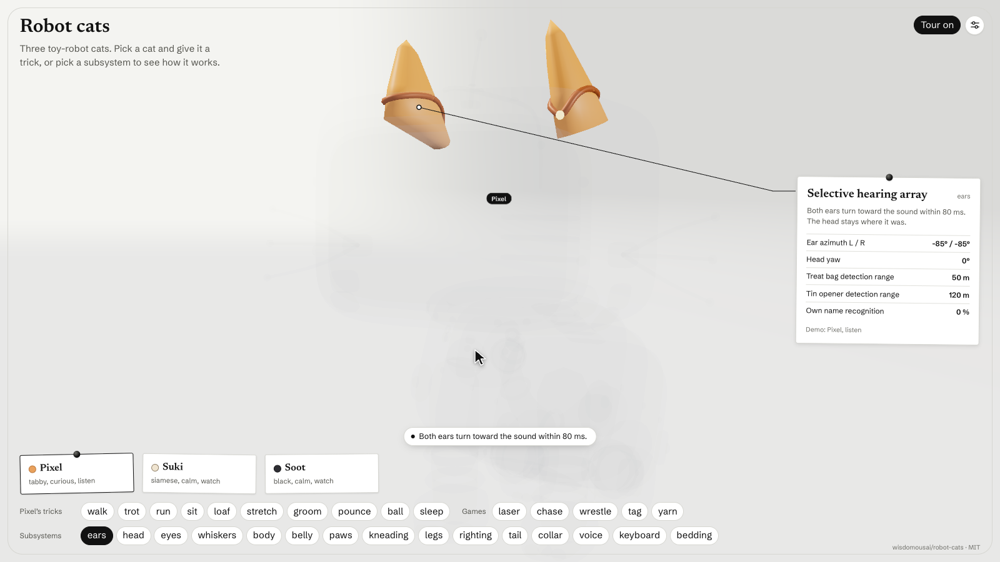

# Robot cats

Three toy-robot cats, built entirely from code in three.js, and a page that takes them
apart. Pixel is a tabby, Suki is a siamese and Soot is black. They walk, groom, knead,
knock cups off a ledge, sleep in a box that is too small for them, and play tag, laser and
yarn with each other.

Each cat cliché is a robot subsystem with its own button. Press "whiskers" and the page
isolates the whiskers, points the camera at them, plays a demo and shows a spec sheet: the
Clearance gauge compares whisker span with the opening before entry, and the result is
advisory.

**[Open the demo](https://wisdomousai.github.io/robot-cats/)**



## Running it

```sh
npm install
npm run dev
```

Open the address Vite prints. When nobody touches the page, a tour presses the buttons with a
fake cursor and explains each one in a caption. Any input pauses the tour, and it carries on
a few seconds after the last input.

| Input | What it does |
| --- | --- |
| Drag | Orbit the camera |
| Wheel | Zoom |
| Keys 1 to 6 | Camera views: 3/4, front, side, top, head, follow |
| Cat cards | Select a cat; the panels show the selected cat |
| Behaviour row | Make the selected cat walk, sit, pounce, sleep, or start a group game |
| Subsystem row | Isolate a subsystem and show its spec sheet |
| X-ray, Explode | Draw the selected cat through everything, or move each part out along its own direction |

URL options: `?seed=N` picks the world's seed, `?tier=N` pins a quality tier (0 is the
highest), and `?debug` exposes the tour and fps samples on `window`.

## Building

```sh
npm run build
```

This writes `dist/cats.html`, one self-contained file of about 940 kB with the scripts and
fonts inlined. It opens from disk with no server. On every push to `main`, the Pages workflow in
`.github/workflows/pages.yml` builds the same file and publishes it as the demo.

`npm run check` type-checks the project and checks that the cat library makes no calls to
the wall clock or `Math.random`.

## How it is made

There are no model files. Every part of every cat is generated in code from primitives,
parented to a skeleton of named bones, and coloured with vertex colours for the coat. Each
joint is driven by a spring toward the angle the cat's behaviour asks for, so all movement
is computed live. The world steps at a fixed 120 Hz from a seeded random generator, so the
same seed always plays the same way.

| Folder | Contents |
| --- | --- |
| `src/cats/model` | Body dimensions, coats, materials and the part list for each breed |
| `src/cats/geo` | Geometry helpers and the props: box, bed, ledge, cup, keyboard, yarn, laser |
| `src/cats/rig` | Skeleton, puppet and the poses for each move |
| `src/cats/brain` | Moods, acts, steering, toys and the group games |
| `src/cats/face` | The screen face: eyes, blinks and expressions |
| `src/cats/cliches.ts` | The subsystem table: every button, spec sheet and tour beat comes from it |
| `src/showcase` | The page: stage, console, live input, tour, cursor and quality tiers |
| `src/dev` | Check pages for the geometry, props, world and console |
| `tools` | Screenshot, fps and determinism scripts (Playwright) |

The check pages are `stage.html`, `world.html`, `console.html`, `gallery.html` and
`props.html`. `docs/conventions.md` lists the axes, bone names and material roles the code
follows.

## Credits

The cats are relatives of Pixel from [@wisdomousai/creatures](https://github.com/wisdomousai/creatures)
(MIT), and the page uses the creatures playground's colours and type: Newsreader and
Schibsted Grotesk, both under the SIL Open Font License, via Fontsource. Built with
[three.js](https://threejs.org).

## License

MIT. See [LICENSE](LICENSE).
